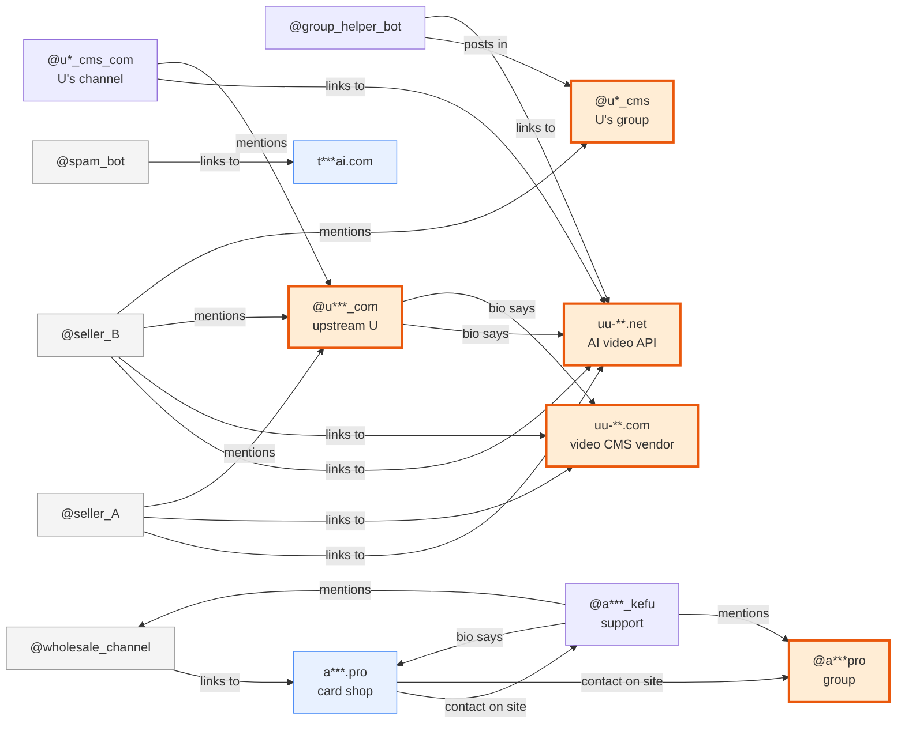

# tg-mcp

English · [中文](README.zh-CN.md)

Let an AI (Claude, or any MCP-capable assistant) work inside your Telegram account: join groups, read messages, search every public post on Telegram, look people up, run groups, send messages, organize folders — **42 tools, 100 features**, one connection shared by every window on your machine.

What makes it different from other Telegram MCP servers: **it grew out of tracing supply chains back to their source** — one sentence draws the chain, one sentence grades a seller.

## One sentence, one supply chain

Tell Claude "read the posts with links in these five groups, follow two hops, where does it come from?" — it calls `trace_source` once and 50 seconds later hands you this graph (a real run; unrelated branches removed, names masked):



> Read 39 posts from 10 sellers, probed 12 sites, re-checked 8 handles. Convergence point: @u***_com (mentioned by 5 accounts).

Read it at a glance: two "sellers" push two sites, and the sites, the bios and the group all point at one upstream U — the sellers are middlemen. The other chain: a channel → its card shop → the support handle the shop lists → whose bio points back at the channel. A closed loop: that one sells its own stock. Orange thick border = where the clues converge; red = flagged as phishing by Cloudflare or flagged by Telegram.

Then say "is @someseller legit?" — it calls `check_seller` once and ten seconds later you get a card: tier A–D, every red flag with the quote it came from:

```json
{"handle":"@v***bot","tier":"C","tier_definition":"证据不足，或长期沉寂，或商业模式风险高  (thin evidence / dormant / risky business model)",
 "red_flags":["活跃度靠刷屏：50 条只有 1 条不同文案（50.0 倍） (activity is spam: 50 posts, 1 distinct text, 50x)"],
 "activity":{"posts_sampled":50,"days_since_last":0,"distinct_texts":1,"spam_ratio":50.0,"posts_with_price":50},
 "provenance":{"edited_old":0,"forwarded_old":0,"via_bot":0},
 "clues":{"domains":["t***ai.com"],"prices":["5 元","98 元","100刀"]},
 "sites":{"t***ai.com":{"verdict":"reachable"}},
 "accusations":[],"related_accounts":[],"confidence":"medium"}
```

Then ask "where does the money from this payment address go?" — same `trace_source`, pass `address`, and it follows the USDT (Tron) transfers two hops down, 14 seconds:

```json
{"summary":"查了 4 个钱包的链上流水。线索汇聚点：TQGB…Zwj2（3 个地址给它打过钱；1 个钱包的钱转到它（资金汇聚）；链上进 2288.0万U、出 1265.0万U）",
 "wallets":{"TNG3…CkVH":{"in_usdt":719414,"out_usdt":6755927,"payers":155,"payees":24,"first":"2026-08-10","last":"2026-09-09",
   "top_out":[{"address":"TQGB…Zwj2","usdt":2879940,"count":2},{"address":"TW3o…oHFp","usdt":1888888,"count":1}],
   "note":"只看了最近 200 笔","explorer":"https://tronscan.org/#/address/TNG3…CkVH"}}}
```

Payment addresses found in posts enter the graph automatically: **two sellers collecting on the same address are one person** — harder evidence than any text clue; whoever the money finally pools at is the upstream.

**Limits**: hops, sites probed, handles re-checked, wallets queried and seconds are all parameters; when a budget runs out, `truncated` says where it stopped. Username lookups are rate-limited by Telegram, so by default only 8 handles are re-checked, one second apart. Sites are probed by fetching the homepage only, private-network hosts are refused, page bodies are never returned. Behind a transparent proxy (fake-ip) the real IP is unknown, so "same server" cannot be judged. On-chain lookups cover USDT on Tron only (where this market collects payment), through Tron's official free API: works without a key, rate-limited when busy, `TRONGRID_API_KEY` raises the limit; the free API gives no address labels (exchange / risk), so each result links to the explorer. Tiers are relative verifiability, not a purchase endorsement.

## A playbook for finding the source

`trace_source` automates the four steps below. To go step by step by hand (or to keep going where it lost the trail):

Scenario: you want to know where some product or service really comes from, and who the middlemen are.

1. **Join the groups and listen** — `join_chat` the relevant groups, `list_messages` to read, `search_global` for keywords: who is quoting prices, which prices, which URLs.
2. **Follow the URLs upstream** — take the storefront sites, look at the APIs and domains behind them, find their suppliers; collect several storefronts and the suppliers start to overlap.
3. **Climb level by level** — repeat for each supplier until you hit the source.
4. **Cross-check back on Telegram** — `get_chat` to profile a person (bio, shared groups, official scam/fake flags), `search_public_posts` across all public Telegram, `list_messages(from_user=…)` to pull one person's entire posting history in a group: real human or not, when they started, are they forwarding stale ads.

Every message carries its **provenance**: forwarded from where, how old the original is, whether it was edited, whether a bot posted it. Someone editing a three-month-old post to a new price and passing it off as fresh stock is obvious at a glance.

Two companion scripts make this **reproducible** (ask about the same seller twice, get the same verdict):

- `market_watch.py` — re-check a list of sellers: still around, still active, old posts still up; scan negative-sentiment corpora; diff against the previous snapshot. Comparing across time is the whole point, so every output is dated and never overwritten.
- `sockpuppet.py` — offline sockpuppet clustering: which accounts are the same person.

## Quick start

```bash
git clone https://github.com/jackchen175x/tg-mcp && cd tg-mcp
uv sync
cp .env.example .env     # fill TELEGRAM_API_ID / TELEGRAM_API_HASH from my.telegram.org/apps
uv run python relogin.py # log in with the code sent to your phone; the session string is written to .env
```

Connect to Claude Code (pick one):

```bash
# Option 1: one process per window (simple, but several windows at once will kick each other out — see below)
claude mcp add -s user telegram -- uv --directory /path/to/tg-mcp run python main.py ~/Downloads

# Option 2: one shared daemon for the whole machine, every window connects by URL (recommended)
uv run python main.py --http ~/Downloads ~/Desktop &
claude mcp add --transport http -s user telegram http://127.0.0.1:8799/mcp
```

The directories at the end of the command are the **only places file tools may read from or write to**; omit them and those tools are disabled (see "Safety").

## Tools (42)

One tool per kind of thing, with an `action` parameter choosing what to do — so the tool list is a third the size of the original 98-tool version with nothing missing.

| Area | Tools |
|---|---|
| Investigation | `trace_source` (one-shot trace: posts → @handles/domains/payment addresses → probe sites for upstream → re-check on Telegram → graph; with `address`, follows USDT money flows) · `check_seller` (one-glance trust card, tier A–D with quoted evidence) |
| Me | `get_me` · `update_profile` (name/bio/photo) · `privacy` (get/set) · `set_bot_commands` · `get_sticker_sets` |
| Chats, channels, people | `list_chats` · `get_chat` (bio, shared groups, online status, photos, scam/fake) · `get_participants` (members/admins/banned) · `list_topics` · `join_chat` (username/link/invite hash) · `leave_chat` · `create_chat` · `edit_chat` · `manage_member` (invite/ban/unban/promote/demote) · `get_invite_link` · `get_recent_actions` · `set_chat_state` (mute/unmute/archive/unarchive) |
| Messages | `list_messages` (latest/keyword/date range/one sender/around a message) · `get_pinned_messages` · `send_message` (text/reply/file/voice/sticker/GIF) · `send_contact` · `edit_message` · `delete_message` · `forward_message` · `pin_message` · `mark_as_read` · `react` (add/remove/list) · `create_poll` · `press_inline_button` · `download_media` · `save_draft` · `get_drafts` |
| Search | `search_global` (everything you can see) · `search_public_chats` (public groups and channels) · `search_public_posts` (all public Telegram, no Stars spent) · `search_gifs` |
| Contacts | `list_contacts` (search/blocked/export) · `manage_contact` (add/delete/block/unblock/import) |
| Folders | `list_folders` · `manage_folder` (create/delete/add_chat/remove_chat/reorder) |

## One session string, one process

If the same session string is used by two processes at once (two windows, Claude plus another tool, two machines), Telegram revokes it: everything disconnects and you have to log in again with a phone code. So:

- Run one daemon (`--http`) and point every window at the URL. While the daemon is running, starting `main.py` in stdio mode refuses to start.
- macOS launch-at-login example: `examples/launchd.plist`; the process exits on its own above 2 GB RSS (`TG_MCP_MEMORY_LIMIT_MB`) and launchd restarts it.
- Another machine or another tool that needs Telegram: register another account and get its own session string.
- After a revocation you'll see `AuthKeyDuplicated`: run `uv run python relogin.py` (the old string is backed up to `.env.bak`).

## Safety

- **Sending files, downloading and changing photos may only touch the directories given at startup**; with none given those tools are disabled. `..` and shell wildcards in paths are rejected; voice notes must be .ogg/.opus, stickers .webp, photos image types, each with a size cap. In stdio mode the client's MCP Roots take precedence.
- The daemon binds `127.0.0.1` only, accepts only local `Host` headers and no web `Origin`, so a web page cannot reach it through your browser (DNS rebinding).
- Errors are **raised**, not returned as strings, so the MCP layer sets `isError` — otherwise an AI running a batch investigation would read "connection lost" as "this seller has no negative history".

## Troubleshooting

- Cannot connect: check `mcp_errors.log` (JSON, warnings and above); `LOG_LEVEL=INFO` for more
- Rate limited (FloodWait): wait the number of seconds shown; numeric IDs trigger fewer limits than @usernames (username resolution hits the server every time)
- Slow start: the first run pulls all dialogs to warm the cache, 10–30 s; past `TG_MCP_STARTUP_TIMEOUT` (default 45 s) it exits rather than hold the session
- Tests: `TG_MCP_LOG=/dev/null uv run pytest -q`

## License

Apache-2.0. Forked from [chigwell/telegram-mcp](https://github.com/chigwell/telegram-mcp).
