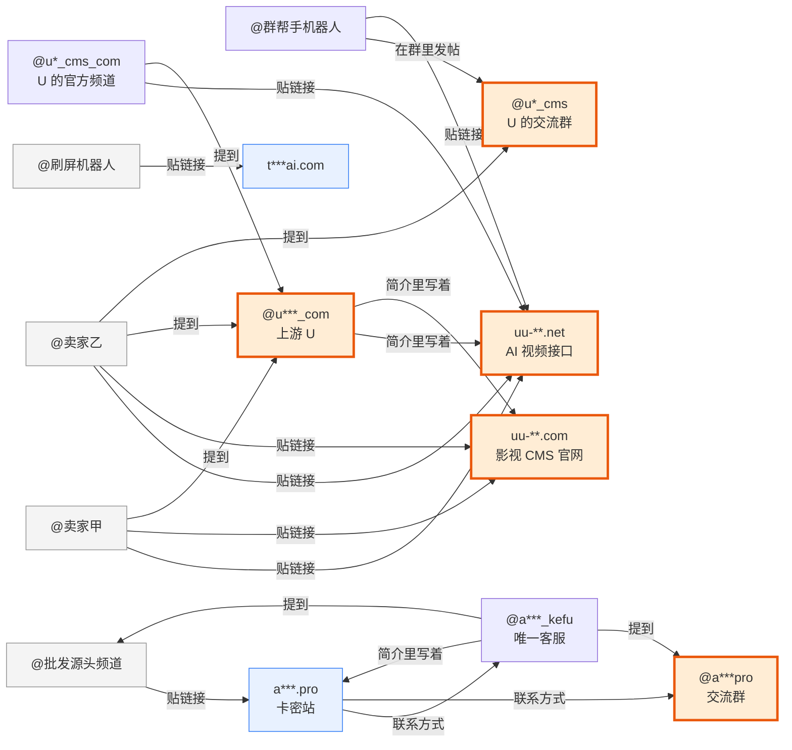

# tg-mcp

[English](README.md) · 中文

让 AI（Claude 或任何支持 MCP 的助手）用你的 Telegram 账号干活：进群、读消息、搜全网公开帖、查人、管群、发消息、整理分组……**48 个工具、106 项功能**，一份连接全电脑共用。

它跟别的 Telegram MCP 不一样的地方：**它是为「顺藤摸瓜找源头」长出来的** —— 一句话画出一条供应链，一句话给一个卖家打分。

## 一句话，画出一条供应链

跟 Claude 说「把这几个群里带链接的帖读一遍，追两层，源头在哪」，它调一次 `trace_source`，50 秒后给你这张图（真实跑出来的，去掉了不相干的分支、名字打码）：



> 读了 39 条帖、10 个卖家，查了 12 个站，核对了 8 个 @号。线索汇聚点：@u***_com（5 个账号提到它）。

看图就懂：两个「卖家」推的两个站，站上、简介里、交流群里全指向同一家 U，他们只是中间商。另一条线：频道 → 卡网 → 卡网上留的客服号 → 客服的简介又写回这个频道，一个闭环，这家是自产自销。橙色粗框是线索汇聚点，红色是被 Cloudflare 判钓鱼或被官方标记的。

再说一句「@某卖家 靠谱吗」，它调一次 `check_seller`，十秒一张卡，A/B/C/D 分档，每条红旗都带原话出处：

```json
{"handle":"@v***bot","tier":"C","tier_definition":"证据不足，或长期沉寂，或商业模式风险高",
 "red_flags":["活跃度靠刷屏：50 条只有 1 条不同文案（50.0 倍）"],
 "activity":{"posts_sampled":50,"days_since_last":0,"distinct_texts":1,"spam_ratio":50.0,"posts_with_price":50},
 "provenance":{"edited_old":0,"forwarded_old":0,"via_bot":0},
 "clues":{"domains":["t***ai.com"],"prices":["5 元","98 元","100刀"]},
 "sites":{"t***ai.com":{"verdict":"reachable"}},
 "accusations":[],"related_accounts":[],"confidence":"medium"}
```

再问一句「这个收款地址的钱去哪了」，还是 `trace_source`，给它 `address`，顺着波场 USDT 的流水往下追两层，14 秒：

```json
{"summary":"查了 4 个钱包的链上流水。线索汇聚点：TQGB…Zwj2（3 个地址给它打过钱；1 个钱包的钱转到它（资金汇聚）；链上进 2288.0万U、出 1265.0万U）",
 "wallets":{"TNG3…CkVH":{"in_usdt":719414,"out_usdt":6755927,"payers":155,"payees":24,"first":"2026-08-10","last":"2026-09-09",
   "top_out":[{"address":"TQGB…Zwj2","usdt":2879940,"count":2},{"address":"TW3o…oHFp","usdt":1888888,"count":1}],
   "note":"只看了最近 200 笔","explorer":"https://tronscan.org/#/address/TNG3…CkVH"}}}
```

帖子里出现的收款地址也会自动进图谱：**两个卖家用同一个地址收款，就是同一个人**，比任何文字线索都硬；钱最后汇到谁那里，谁就是上游。

给一个卡网域名也能直接开挖：`trace_source(site="…", deep_sites=1)` 抓它首页找联系方式和接口，再去三个免费公开接口查它背后——**同一张证书上还签了哪些别的站**（同一个人买的证书）、**同一台服务器上还有哪些站**（让对方按域名查，本机走代理也不碍事）、**注册商 / 注册日期 / 注册人 / 域名服务器**；兄弟站进图谱连「同证书」「同服务器」「同注册人」三种线。最早证书比本次注册还早的，标「域名换过主人，老口碑不作数」；卖家卡片加 `deep_sites=True`，卡网域名一个月内才注册的直接亮红旗。

查出来的骗子别只留在自己脑子里：`scam_list` 是一份**可共享的骗子库**。`add` 对一个 @号 跑一遍卖家一眼看，把档位、红旗、群里的原话证据、收款地址、卡网连同你自己的一句备注存成一行；`query` 按 @号、数字 ID、收款地址或卡网查；`merge` 把别人发来的名单文件并进来；`export` 导成 Rose 群管机器人能一键导入的联盟封禁格式，群主直接封人。规矩抄自跑得通的社区做法：**只认改不掉的数字 ID**（用户名只当别名，改名也跑不掉）、**没有证据不入库**（原话要带群和日期，自己的话要带举报人）、合并只追加不删、档位取最重。入库之后卖家一眼看会自动查库：库里有他，或者他跟库里的人共用收款地址，直接 D 档。

查过一次不算完：`market_radar` 是**市场雷达**。`add` 把一个卖家（@号）或一条溯源线（关键词 / 几个群）加进盯梢清单，顺手拍第一张快照；`run` 只重查清单上这些对象（不全网重爬，几十秒，不撞限速），跟上一张快照比：跑路了、换档了、改名了、被官方标记了、新多了几条指认、卡网或报价变了、钱改转去哪了、溯源线上冒出新卖家、汇聚点换了——一行一条合成一段，**有变化才推送**。推送走环境变量 `RADAR_NOTIFY_CMD`（一条 shell 命令，文本从标准输入进去：飞书、Slack、任何推送命令都行）；设了 `RADAR_EVERY_HOURS=24`，常驻进程每天自动跑一轮，按文件里记的上次时间算，重启不重置。快照一张张带日期追加、不覆盖，`history` 能翻任何一个对象的全部历史。

谁是时间上的源头：`who_first` 给一段话术、一个卡网、一个 @号 或收款地址，按线索和文案片段去搜（自己加入的群 + 全网公开帖），搜到的帖按**文案指纹**归成几组（抹掉零宽字符、间隔号这些躲检索的花样再比），每组按时间排：最早那条是谁、在哪个群、什么时候发的，之后哪些号跟着发、各自从哪天开始。**转发帖按原帖的时间和作者算**，原频道没搜到也能指到它；只给个开头几句也认得出是同一条。顺带给每条线索的首次出现时间。卖家一眼看的卡片也多了一栏「最早出现」：他在群里的第一条帖和最早被人提到，取更早的 —— 上周才冒出来的「源头」和混了两年的老店，一眼分开。边界：Telegram 搜中文长句不准，长文案自动拆成短句搜；搜索结果从新到旧、每个词只翻 `limit` 条，没翻到底时结果里明说。

进一个新群先摸底：`group_profile` 读最近几百条帖，一句话说清这个群**是干什么的**（卖场 / 讨论群 / 机器人刷屏 / 单向频道）、多少人、哪天建的、每天多少帖、前三个号占了多少、**广告占比**（带报价、带卡网链接、叫卖词加联系方式的算广告）、**机器人**几个发了多少（只认官方标记，不猜）、**疑似同一人**哪几对（共用收款地址 > 同一个卡网 > 名字同源 > 发过一模一样的文案）、群里**骂人的帖**多少、谁被点名最多，以及主要卡网、常见报价和收款地址。活跃号前十一张表：发了几条、几条是广告、几种不同文案、最后一帖、卡网、@的人、收款地址。全部从消息里算，不逐个解析用户名，不碰限速；进群退群提示和纯图不算帖。实测一个一万四千人的群 8 秒出结果，顺手抓到五个洋名号互发同一段文案的刷屏团伙。

报价贵不贵、低得正常不正常，得有行情才判得出：`price_board` 读市场所在的几个群最近几百条帖，把每个价钱配给它前面的品类（GPT Plus、Claude 20x、GPT Pro 5x……；配对一律取价格**前面**的品类，报价单永远是「品类 价格」，按「最近」配会把 278 配给后面那个 Claude 20x；中间夹着「7 天」「年付」「席位」「合租」的另算一类，别拿月价去判它），按品类给出**中位数、离散度、低价红线**（中位数减三个绝对偏差，夹在五成到八成之间——用中位数不用均值，这个市场长尾，几条离谱高价就能把均值拉飞）、近 7 天涨跌、最便宜的三家、**低于红线的报价**（低到不可能，多半是假货或钓鱼）和**活跃却从不报价的号**（「详情卡网」「私聊」不是数据缺失，是该扣分的地方）。同一家刷 50 遍同一张报价单只算一条，中位数不被刷屏的人定。行情表存成文件后，`check_seller` 的卡片多一栏 `prices_vs_market`：这家每条报价对行情是便宜、贵还是差不多，**低于红线直接亮红旗降到 C 档**。实测五个群 582 条帖 14 秒出表，174 条 GPT Plus 报价中位 99 元。

骗子的核心手法是换名字：被曝光、弃号、开新号、在同一个群继续卖，只按 @号 追，换个马甲负面记录就归零。`same_person` 按**他甩不掉的东西**追：读几个群的最近帖子，共用收款地址、同一个微信或邮箱、一模一样的整套报价单、群友明说「他从 @a 改成了 @b」——这四样一条就成案；同一个卡网链接、一样的文案、转发同一个源头、被同一条曝光帖点名是弱证据，要两条；名字同源只当助攻。并查集把「A 和 B 一伙、B 和 C 一伙」自动推成一组；超过 8 个人共用的链接当公共平台不算；曝光帖里的地址算到被曝光的人头上，不算到发帖的受害者。给 `handle` 只看这个卖家自己那一组。输出的是证据不是判决，**差一条证据的配对单独列出来**让人看。离线版 `sockpuppet.py` 规则相同，吃扫描快照。

要发出去给人看，加一个 `report=True`：同一次调用顺手在你的下载目录里生成一个网页文件，点开就是**能拖、能缩放、按类型筛、一键存图、一键打码、导出 GEXF 给 Gephi** 的互动图谱，下面附汇聚点、卖家、网站、钱包四张表；`check_seller` 加 `report=True` 则出一张带证据原话的卡片页。没接 MCP 的人把工具返回的 JSON 存成文件，`python -m tg_mcp.report trace.json` 也能生成同样的网页。


**边界**：追几层、查几个站、核对几个 @号、查几个钱包、最多几秒都是参数，用完了在 `truncated` 里明说停在哪。核对 @号 会触发 Telegram 限速，所以默认只核对 8 个、每个隔 1 秒。抓站只抓首页、拒绝内网地址、不回传网页内容；本机走透明代理（fake-ip）时拿不到真实 IP，判不了「同一台服务器」。网站深挖走 crt.sh、HackerTarget（免费每天 20 次）、rdap.org 三个公开接口，Cloudflare 后面的站查不到同服务器、注册人多半打码，这是接口的天花板不是没查。链上只查波场 USDT（灰产收款的主流），走波场官方免费接口，不带钥匙能用、查多了会限速，环境变量 `TRONGRID_API_KEY` 可放宽；地址是交易所还是风险地址，免费接口不给标签，结果里带浏览器链接自己看。分档只是相对可核查度，不是购买背书。

## 一套找源头的打法

`trace_source` 就是下面这四步的自动化版。想手动一步步来（或者它追丢了接着追），用这些：

场景：你想知道某种货或服务真正的源头在哪、中间商都是谁。

1. **进群听人说话** —— `join_chat` 进相关群，`list_messages` 读、`search_global` 搜关键词：谁在报价、报什么价、贴了什么网址。
2. **顺着网址找上游** —— 拿到供货网站，看它背后调的接口和域名，找到它的上游；多找几个供货网站，上游会重叠。
3. **一层层往上追** —— 对上游再做一遍，直到追到源头。
4. **回 Telegram 核对** —— `get_chat` 查人（简介、共同群、官方 scam/fake 标记），`search_public_posts` 搜全网公开帖，`list_messages(from_user=…)` 把一个人在群里的全部帖子拉出来：是不是真人、什么时候开始发、转的是不是老帖。

每条消息都带「来路」：转发自哪、原帖多久之前、改过没、是不是机器人代发。把三个月前的老帖改个价冒充现货，在这里一眼看穿。

配套两个脚本把这套做成**可复算**的（同一个卖家问两次得到同一个结论）：

- `market_watch.py` —— 定点复查一批卖家：还在不在、活不活跃、旧帖在不在；扫负面语料；跟上一次快照比对。跨时间比对是全部价值，所以产物都带日期、不覆盖。
- `sockpuppet.py` —— 纯离线马甲聚类：哪些号是同一个人。

## 快速开始

```bash
git clone https://github.com/jackchen175x/tg-mcp && cd tg-mcp
uv sync
cp .env.example .env     # 填 TELEGRAM_API_ID / TELEGRAM_API_HASH（my.telegram.org/apps 申请）
uv run python relogin.py # 手机收验证码登录，凭证写进 .env
```

接到 Claude Code（两种，选一）：

```bash
# 方式一：每个窗口各起一份（简单，但多个窗口同时开会互相挤下线，见下文）
claude mcp add -s user telegram -- uv --directory /path/to/tg-mcp run python main.py ~/Downloads

# 方式二：全电脑只开一份常驻，各窗口用网址连它（推荐）
uv run python main.py --http ~/Downloads ~/Desktop &
claude mcp add --transport http -s user telegram http://127.0.0.1:8799/mcp
```

命令末尾的目录是**允许发文件 / 下载文件的目录**，不给就禁用那几个工具（见「安全线」）。

## 工具（48 个）

一个工具管一类事，用 `action` 参数选具体动作，所以工具清单只有原版三分之一大，功能一项不少。

| 类别 | 工具 |
|---|---|
| 调研 | `trace_source`（一键溯源：搜帖 → 抽 @号/网址/收款地址 → 抓站找上游 → 回 Telegram 核对 → 图谱；给 `address` 追 USDT 资金流向，给 `site` 挖网站背后：同证书 / 同服务器 / 注册信息；`report=True` 出互动图谱网页）· `check_seller`（卖家一眼看：分档卡片，带原话证据，自动查骗子库）· `scam_list`（骗子库：add / query / merge / export / stats，导出 Rose 联盟封禁格式）· `market_radar`（市场雷达：add / run / list / history / remove，盯卖家和溯源线，跟上次快照比，有变化一行一条推出去）· `who_first`（谁最早：一段话术 / 一个卡网 / 一个 @号，最早谁在哪发的、之后谁在抄）· `group_profile`（群画像：干什么的、谁最活跃、广告占比、机器人、疑似同一人、谁被骂）· `price_board`（价格行情：按品类算中位数、低价红线、趋势、最便宜的卖家、低到不可能的报价、从不报价的号；卡片按它判「报价对行情」）· `same_person`（马甲识别：哪些号是同一个人，一条强证据或两条弱证据成案，差一条的单独列） |
| 我自己 | `get_me` · `update_profile`（名字/简介/头像）· `privacy`（get/set）· `set_bot_commands` · `get_sticker_sets` |
| 群 / 频道 / 人 | `list_chats` · `get_chat`（简介、共同群、在线状态、头像、scam/fake）· `get_participants`（成员/管理员/被封）· `list_topics` · `join_chat`（用户名/链接/邀请码）· `leave_chat` · `create_chat` · `edit_chat` · `manage_member`（invite/ban/unban/promote/demote）· `get_invite_link` · `get_recent_actions` · `set_chat_state`（mute/unmute/archive/unarchive） |
| 消息 | `list_messages`（最新/搜词/按日期/只看某人/某条前后）· `get_pinned_messages` · `send_message`（文字/回复/文件/语音/贴纸/GIF）· `send_contact` · `edit_message` · `delete_message` · `forward_message` · `pin_message` · `mark_as_read` · `react`（add/remove/list）· `create_poll` · `press_inline_button` · `download_media` · `save_draft` · `get_drafts` |
| 搜索 | `search_global`（自己能看到的所有聊天）· `search_public_chats`（公开群和频道）· `search_public_posts`（全网公开帖，不花星星）· `search_gifs` |
| 联系人 | `list_contacts`（搜/黑名单/导出）· `manage_contact`（add/delete/block/unblock/import） |
| 分组 | `list_folders` · `manage_folder`（create/delete/add_chat/remove_chat/reorder） |

## 一串凭证只给一个程序用

同一串登录凭证同时被两个程序用（两个窗口、Claude 和另一个工具、两台电脑），Telegram 会直接作废它，所有地方一起掉线，只能重新收验证码登录。所以：

- 推荐常驻一份（`--http`），各窗口连网址。常驻那份在跑时，再用 stdio 方式起 `main.py` 会直接拒绝。
- macOS 开机自启的写法见 `examples/launchd.plist`；内存超 2G（`TG_MCP_MEMORY_LIMIT_MB`）自己退出让 launchd 拉起。
- 别的机器或别的工具要用 Telegram：另注册账号、另拿一串凭证。
- 凭证被作废后报 `AuthKeyDuplicated`：跑 `uv run python relogin.py`（旧凭证备份成 `.env.bak`）。

## 安全线

- **发文件 / 下载 / 换头像只许碰启动时给的目录**，没给就禁用这几个工具；路径里的 `..`、通配符一律拒绝；语音只收 .ogg/.opus，贴纸只收 .webp，头像只收图片，各有大小上限。stdio 模式会优先问客户端的 MCP Roots。
- 常驻模式只听 `127.0.0.1`，只认本机 Host、不认任何网页 Origin，网页借浏览器冒充本机调不到。
- 出错**以异常抛出**而不是返回一段字，MCP 协议层才会标 isError —— 否则 AI 在批量调查里会把「连接断了」当成「这个卖家没负面记录」略过。

## 排障

- 连不上：看 `mcp_errors.log`（JSON 格式，只记 warning 以上）；`LOG_LEVEL=INFO` 看更多
- 限速（FloodWait）：等提示的秒数；用数字 ID 比 @用户名 少触发限速（用户名解析每次都查服务器）
- 启动慢：首次要拉全部会话预热缓存，10~30 秒；超过 `TG_MCP_STARTUP_TIMEOUT`（默认 45 秒）自动退出，免得占着凭证
- 测试：`TG_MCP_LOG=/dev/null uv run pytest -q`

## 许可

Apache-2.0。改自 [chigwell/telegram-mcp](https://github.com/chigwell/telegram-mcp)。
